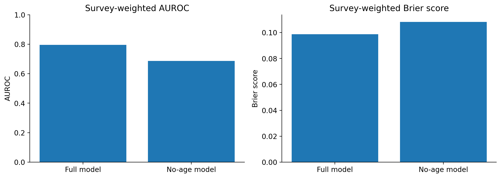
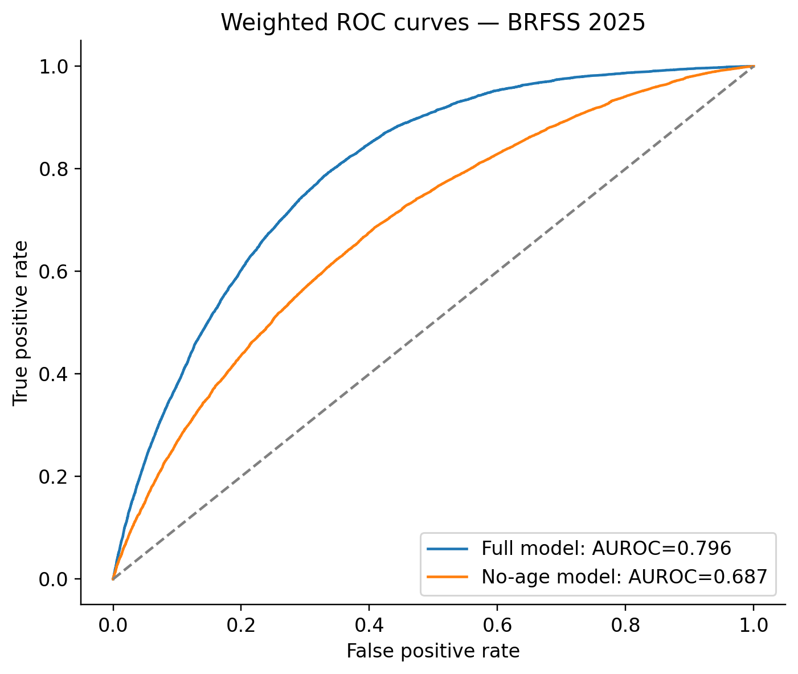
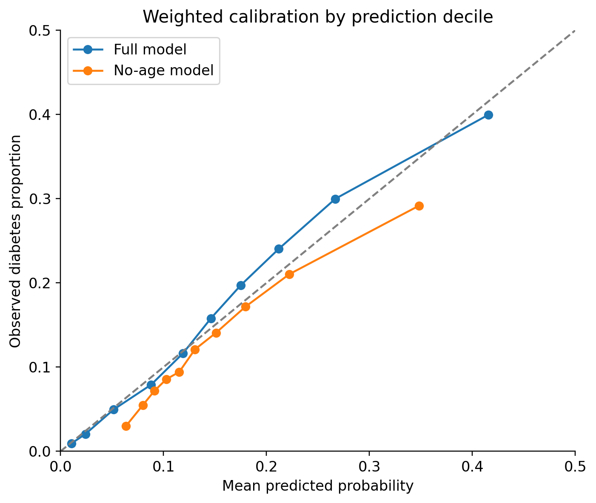
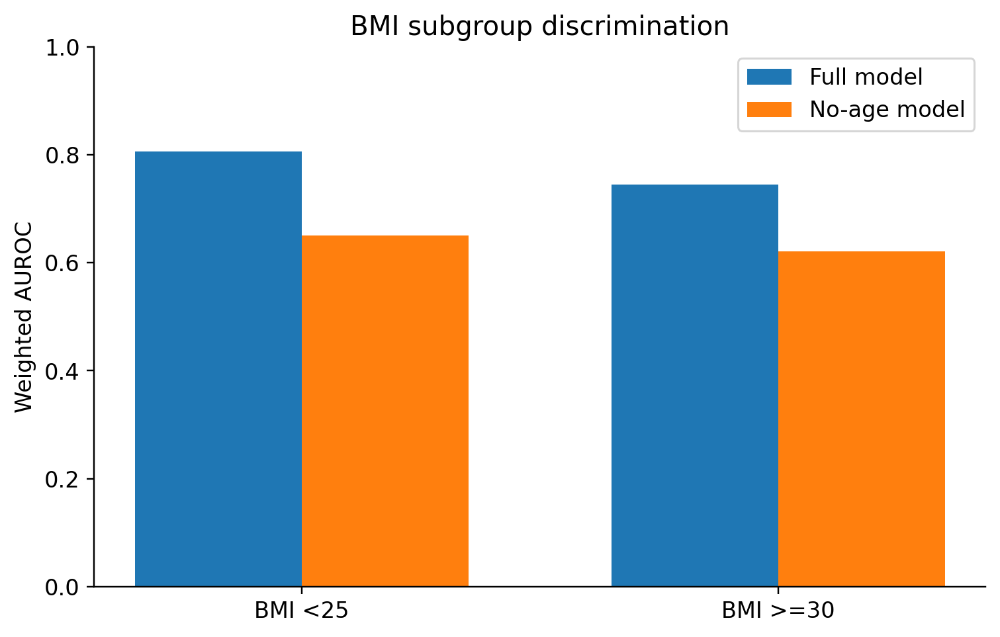
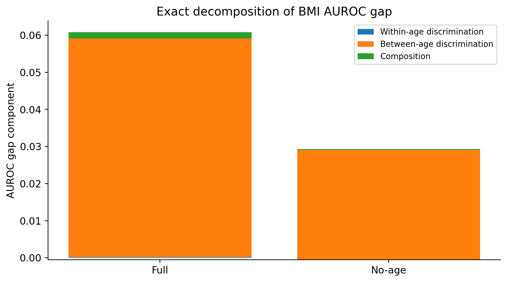
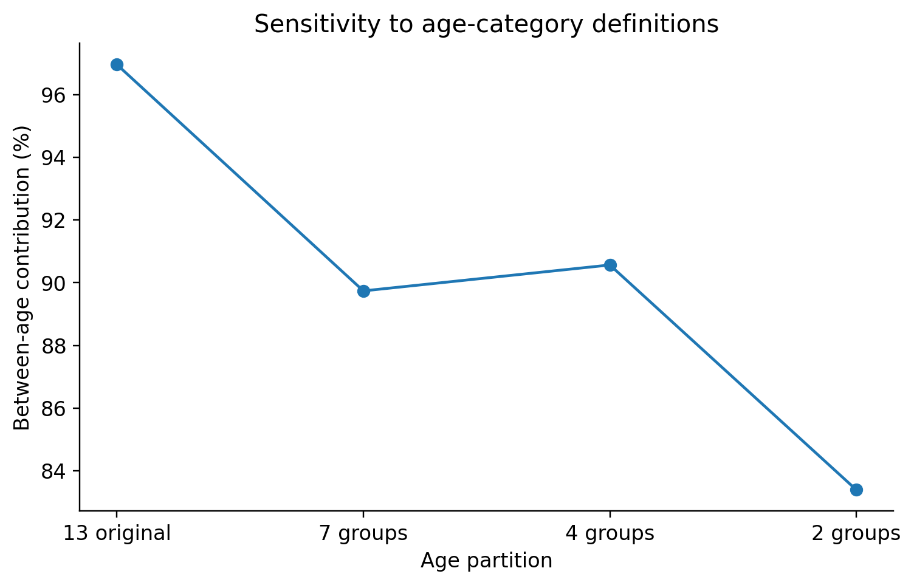
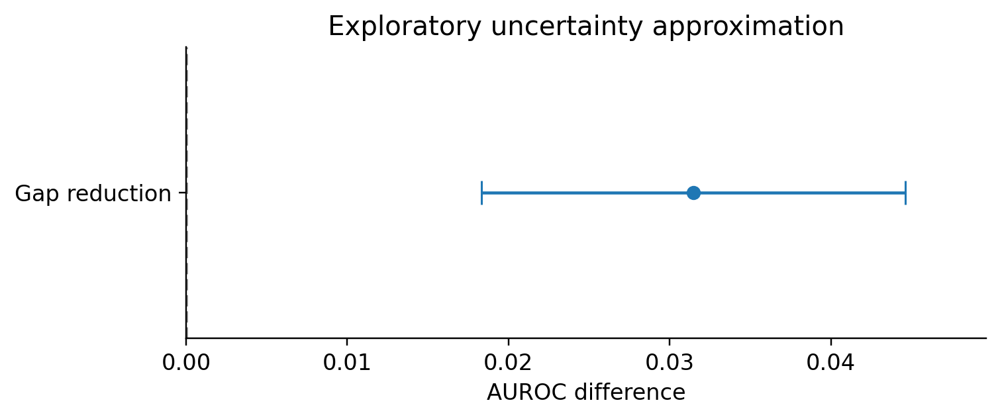

# Diabetes Classification and Subgroup AUROC Analysis

Reproducible applied statistical analysis of **self-reported prevalent diabetes** using the CDC Behavioral Risk Factor Surveillance System (BRFSS), with 2024 data for training and 2025 data for evaluation.

> **Research scope:** This is cross-sectional classification of a survey-reported outcome, **not** prediction of future diabetes onset, a clinical diagnostic model, a causal analysis, or an established fairness intervention.

## Project at a glance

| Item | Description |
|---|---|
| Training cohort | BRFSS 2024; 441,934 eligible records |
| Evaluation cohort | BRFSS 2025; 342,539 eligible records |
| Primary model | Logistic regression with median imputation and one-hot encoding |
| Predictors | Age group, BMI, sex, exercise, smoking history, education |
| Evaluation | Survey-weighted AUROC and Brier score; exploratory subgroup analyses |
| Implementation | Python, scikit-learn, pandas, NumPy, SciPy |

## Main results

| Metric (2025 evaluation, all eligible) | Full model | Model without age |
|---|---:|---:|
| Weighted AUROC | **0.795546** | 0.687464 |
| Weighted Brier score | **0.098758** | 0.108311 |

On the **age- and BMI-complete extreme-BMI subgroup** (BMI <25 versus BMI >=30; N=198,129), the weighted AUROC gap decreased from **0.060787** to **0.029308** when age was excluded: an observed reduction of **0.031479 (about 51.8%)**. The reduced gap came with a substantial decline in overall discrimination. It should **not** be interpreted as proof of causal age effects, fairness improvement, or clinical benefit.

An exact within-age/between-age case-control-pair AUROC accounting identity was applied to the BMI gap. With 13 age categories, the full-model gap was partitioned into within-age discrimination (**0.000205**), between-age discrimination (**0.058936**) and pair-composition (**0.001646**). These contributions depend on the age partition and decomposition convention; they are not causal attributions.

## Visual results

The following images are maintained at the repository root:















## Reproduce the core model

The CDC raw data are **not included**. Obtain the BRFSS 2024 and 2025 SAS transport files from the CDC and place them under a local directory as `LLCP2024.XPT` and `LLCP2025.XPT` (remove any trailing spaces from filenames).

From the repository root:

```bash
python -m pip install -r requirements.txt
python -m pytest -q test_v11.py
python run_v11.py --data-dir /path/to/cdc_xpt --output-dir results_v11
```

The script writes `common_cohort_comparison_2025.csv` and `.json`. Select `strategy=median` and `cohort=all_eligible` to compare with the reported **0.795546 weighted AUROC** and **0.098758 weighted Brier**. If the source files are in a `src/` folder instead, prefix the Python filenames with `src/`.

**Independent execution check (23 October 2026):** A fresh copy of the uploaded GitHub repository was executed in Google Colab using the original CDC files. The run completed successfully with training N=441,934 and evaluation N=342,539, and reproduced both primary weighted metrics to six decimal places. Two basic pipeline tests passed; this is **not** exhaustive verification of every notebook analysis.

## Interpretation and limitations

- The 2025 data were evaluated repeatedly during development; they are not an untouched external final test set.
- Confidence intervals and bootstrap estimates for subgroup decompositions are **exploratory**; full validity under the complex BRFSS sample design has not been established.
- BRFSS uses a complex survey design, and weighted point estimates alone do not validate variance estimates.
- Complete-case comparisons use different sample definitions; compare imputation methods on the common cohort where appropriate.
- The AUROC decomposition is an exact algebraic identity, not evidence of methodological novelty or causal mechanisms.
- The project has not demonstrated clinical utility, prospective generalization, or publication-level methodological originality.

For fuller methodological details and verification boundaries, see [TECHNICAL_REPORT.md](TECHNICAL_REPORT.md) and [VALIDATION_STATUS.md](VALIDATION_STATUS.md).

## Data source

CDC Behavioral Risk Factor Surveillance System (BRFSS): https://www.cdc.gov/brfss/
